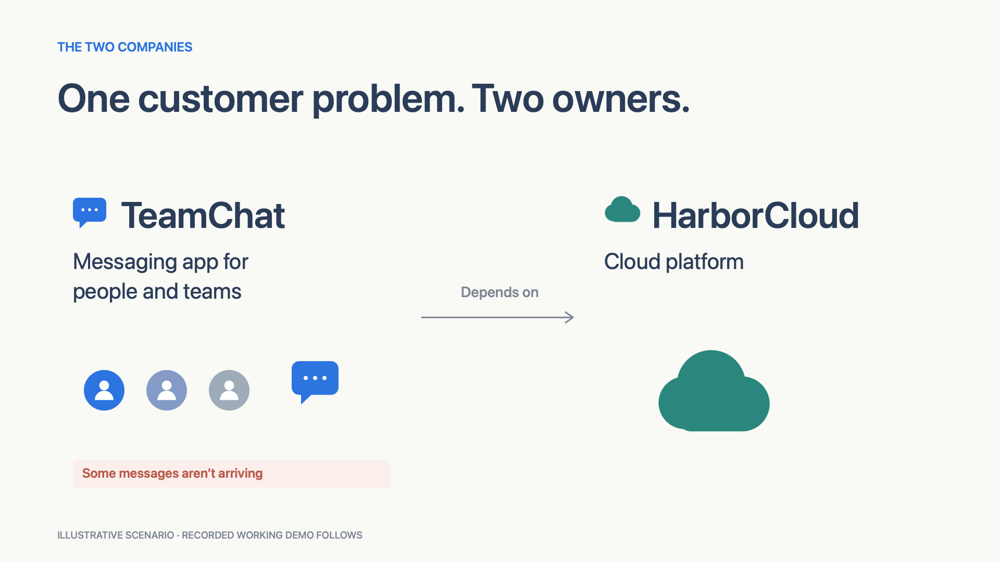
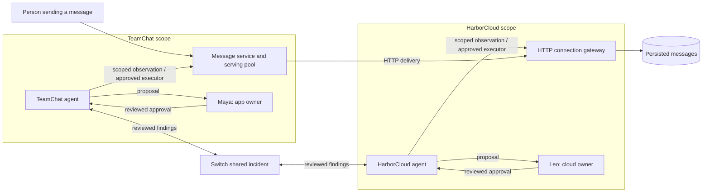

# Relay

**Two companies. One shared recovery. Built with Switch.**

[](https://github.com/Krishna3451/relay-switch/actions/workflows/tests.yml)

You send an important message. The other person never receives it.

In this demo, **TeamChat** is a messaging app for people and teams. It relies on
**HarborCloud**, a cloud platform. The cloud connection is overloaded, and parts
of TeamChat's message service fail to start. HarborCloud can repair its connection
while TeamChat's customers still cannot receive messages reliably.

Relay brings each company's agent into the same incident through **Switch**.
Each agent investigates its own systems. People review what gets shared and
approve changes to their own side. Both teams check whether messages actually
arrive before calling the recovery complete.

Logs can contain customer information and private system details. Sharing them
wholesale is often inappropriate, and preparing a useful finding takes work.
Relay's agents prepare incident-scoped findings; an enrolled owner reviews the
exact text before it crosses to the other company. A finding can generate another
question, so the shared incident carries the investigation forward between teams.

[Explore the interactive showcase](https://krishna3451.github.io/relay-switch/) ·
[Watch the 2:26 Mattermost demo](https://youtu.be/6Qyd5QiBLIM) ·
[Download the final video](demo/final-v4/delivery/Relay-final.mp4) ·
[Captions](demo/final-v4/delivery/Relay-final.srt) ·
[Run locally](#run-locally) · [Evidence](#evidence)

[](https://youtu.be/6Qyd5QiBLIM)

> TeamChat and HarborCloud are fictional. The video uses live model decisions,
> actual Switch messages and real local HTTP recovery checks. One presenter
> roleplays the two enrolled reviewers; their approval inputs are scripted.
> The opening is an editorial illustration, and selected waiting time is edited.

## The incident, in five steps

1. **Messages fail.** A real concurrent workload overloads the connection route
   and leaves failed service allocations occupying TeamChat's serving pool.
2. **TeamChat asks for the missing evidence.** Its agent checks its own service,
   prepares a focused question, and waits for Maya to approve sharing it.
3. **HarborCloud repairs its side.** Its agent receives the approved question
   through Switch. Leo reviews the capacity change. After execution, all six
   cloud connection checks pass—but a fresh app check still delivers only 15 of
   24 messages.
4. **TeamChat finishes the recovery.** The verified cloud result moves its agent
   forward. Maya approves recovery of the named failed service starts. The same
   24-message workload now delivers 24 of 24.
5. **An earlier failed message is retried.** Its original ID and text are preserved.
   A repeated identical request is recognized as a duplicate and leaves one
   persisted message.

The important stopping condition is **customer delivery**, not an agent saying
that its own company has finished its task.

## Why Switch matters

The app company does not grant its agent access to the cloud provider's private
diagnostics or operations. The cloud provider's agent cannot repair the app.
They need to exchange evidence across that ownership boundary.

**Switch supplies the agent/chat transport and identity context. Relay supplies
the scoped tools, review workflow, action bindings and recovery logic.**
An approved finding becomes an actual Switch message. The opposing agent wakes
only after receiving the counterpart event and reading back the shared post.
The interaction is visible inside Mattermost: a shared incident thread plus a
private workroom for each company.

In the recorded run, Maya approves a short finding that includes a focused
question for HarborCloud. That complete approved text crosses the boundary;
the more detailed TeamChat diagnostic context does not. The video traces the
same text from its private review into the shared incident. Operation plans
and results have separate, explicit reviews too.

This fixture contains no real customer records. The sensitive-record examples
in the opening are labelled illustrations. Relay demonstrates scoped contexts
and reviewed disclosure; it is not an automatic PII redactor or a guarantee
against an owner approving an inappropriate finding.

APIs still perform the actual diagnostics and changes. A central agent granted
equivalent access to both companies is a valid alternative. This project shows
how agents can work across separate access and ownership; it does not claim that
two agents are inherently necessary or faster.

## Architecture

The delivery path and the investigation path are separate. Switch carries the
investigation; ordinary HTTP requests measure whether the service recovered.



All services run on one trusted local demo host. The diagram represents company
and credential scopes, not separate machines or hostile-host isolation.

## What is implemented

| Mechanism | Concrete behavior |
|---|---|
| Separate investigators | Each model receives only its company's observations and actual approved peer messages. No tool calls are accepted from model output; the trusted runner holds credentials. |
| Separate read and apply authority | An investigator can propose a change. A separate executor credential is required to apply it after approval. |
| Source-bound approval | Native owner replies must match the enrolled actor, original Mattermost source post, exact review root and corresponding Switch thread. |
| Bound operations | The approved proposal binds its digest, expected resource revision, target resources and expiry. Wrong-owner, stale, altered and replayed decisions are rejected. |
| Reviewed disclosure | A finding or plan waits for its owner's review before it is released. A shared plan is not treated as proof of successful execution. |
| Actual peer transport | Switch events are stored before acknowledgment. Cross-company work waits for the received event and Mattermost readback, rather than a direct lookup of the other role's diagnostics. |
| Measured recovery | The gateway has an independent six-request check. The app has a fresh 24-message delivery check with an explicit latency target and resource revisions. |
| Idempotent retry | A retry preserves message identity and content. An identical repeated request is a duplicate; conflicting content under the same ID is rejected. |

The gateway's admission limit produces real HTTP timeouts. Failed readiness
requests leave inspectable failed allocations. There is no
`app_fixed && cloud_fixed` flag deciding success: HTTP results, latency and SQLite
message rows determine the outcome.

## Evidence

Two different experiments answer different questions. Their measurements are
reported separately.

**1. Causal check: does recovery require both interventions?**
Each arm starts fresh and receives 24 real HTTP requests at concurrency 12, with
the same 1,100 ms p95 target. This check makes no model calls and does not need
Switch.

| Intervention | Messages delivered | p95 HTTP latency |
|---|---:|---:|
| Neither | 14/24 | 770.30 ms |
| App only | 14/24 | 782.09 ms |
| Cloud only | 14/24 | 788.81 ms |
| Both | 24/24 | 347.01 ms |

[Causal report](evidence/causal-proof.json)

**2. Recorded native run: did the agents coordinate through Switch?**

| Stage | Cloud connection | Fresh app delivery | App p95 |
|---|---:|---:|---:|
| Incident | Not repaired | 13/24 | 781.03 ms |
| Cloud change executed | 6/6 passed | 15/24 | 823.19 ms |
| App recovery, before retry | Already verified | 24/24 | 355.58 ms |
| Closing check, after retry | Already verified | 24/24 | 341.11 ms |

The recorded run used **12 live model calls**, **six reviewed Switch releases**
and **nine original reviewer source posts**. All eleven native source/outcome
audit checks passed. The selected earlier failed message was delivered using
its unchanged ID and body; the repeated retry left exactly one database row.

[Native run summary](evidence/native-verification.json) ·
[Verification notes](evidence/VERIFICATION.md)

These are small local functional checks, not a production reliability benchmark
or a measured speed comparison with human support or a central agent. Published
reports contain curated summaries; runtime credentials and raw session archives
are excluded.

The recorded measurements precede the final first-run, local-request and peer
packet hardening. Their source hashes remain historical rather than being
rewritten to match later code. The published implementation passed **54 unit
tests** (16 backend and 38 agent/native checks), a fresh four-arm causal check,
and an offline replay of all six recorded owner reviews through the minimized
disclosure format. That replay made no model calls or Switch posts.

[Current source audit](evidence/submission-audit.json) ·
[Fresh causal check](evidence/submission-causal-proof.json)

## Run locally

The [GitHub Pages site](https://krishna3451.github.io/relay-switch/) tells the
incident through an animated, illustrated walkthrough, then shows the recorded
Mattermost demo with English captions. Follow the approved finding between
companies and see why a healthy cloud check still leaves messages undelivered.
It is a static showcase; it does not run the agents or repair infrastructure.
Its buildless HTML, CSS and JavaScript live in `docs/`. Preview the site with
`python3 -m http.server 4339 --directory docs`. GitHub Pages publishes `main:/docs`.

### 1. Install and verify the core

Use **Python 3.12 or newer**. The application, gateway and causal check use the
standard library. `requirements.txt` lists the direct bridge dependencies;
`requirements-lock.txt` records the complete dependency set used for validation.

```sh
git clone https://github.com/Krishna3451/relay-switch.git
cd relay-switch
python3.12 -m venv .venv
.venv/bin/python -m pip install -r requirements-lock.txt

.venv/bin/python -m unittest discover -s tests -v
.venv/bin/python -m unittest discover -s tests_agents -v
.venv/bin/python -m engine.proof --output .runtime/causal-proof.json
```

The unit tests use explicitly named fake models/transports. The recorded live
run above is separate evidence. Tests cover owner/thread binding, tampering,
revision/expiry/replay checks, role histories, transport-triggered work,
recovery validation and retry behavior.

Start the application and gateway without any model or Switch dependency:

```sh
.venv/bin/python scripts/start-demo.py --engine-only
```

The diagnostic console is at `http://127.0.0.1:4318`. It is a backstage inspection
surface; the product demonstration takes place in Mattermost.

### 2. Connect the live agents

The current live integration targets an installed **macOS Switch Console native
runtime** with a configured, running **Mattermost bridge**. It also requires an
authenticated **Codex CLI** on `PATH` (or set `CODEX_BIN`). This is a local
operator setup, not a portable production deployment.

For Switch room concepts and account setup, see the
[official Switch getting-started guide](https://docs.switchagents.ai/switch-rooms/getting-started).
Relay's native adapter still requires the local runtime described here.

Enrollment requires access to the local Switch runtime metadata and creates
fictional identities and private channels in that local demo tenant. Use a
workspace where you are authorized to do so. The runtime and bundle paths can
be configured with `RELAY_SWITCH_RUNTIME` and `RELAY_SWITCH_BUNDLE`.

With the engine running, use a second terminal:

```sh
.venv/bin/python -m agents.native_enroll
.venv/bin/python -m agents.native
```

Native enrollment prepares three rooms: `RELAY · Incident`,
`TeamChat · Maya review` and `HarborCloud · Leo review`. Private runtime
configuration contains the enrolled sessions and room URLs; it must remain
local.

The recorded presentation advances through explicit gates. The `incident` gate
creates the real offered workload and posts Maya's report. Later gates send
scripted presenter replies through the enrolled reviewer accounts. The resulting
original Switch events—not the web approval API—drive the native workflow.
Manual enrolled-owner replies are also supported:

```text
Share with HarborCloud
Approve this change
Share this result
Retry this message
```

Replies belong in the exact review card's thread. See
[the agent and native workflow guide](agents/README.md) for stage order, API
details and lifecycle behavior. Stages wait for explicit cues or enrolled-owner
replies.

## Repository map

```text
engine/       Actual HTTP app, gateway, persistence and four-arm causal proof
agents/       Scoped model decisions, Switch transport, approvals and native bridge
tests/        Backend behavior and recovery tests
tests_agents/ Approval, transport, context and lifecycle boundary tests
web/          Diagnostic console
scripts/      Launch, capture, narration and video assembly tools
evidence/     Curated historical measurements and verification notes
demo/         Final video, captions, narration script and selected QA artifacts
```

Media production is optional. The included tools record actual Mattermost views
and assemble the demonstration; recapturing requires the local Switch setup and
an isolated Chrome session. The editorial animation renderer uses macOS Swift,
AppKit/CoreGraphics and ffmpeg. Raw capture archives, service databases, session
files and provider account metadata are not part of the public package.

## Scope and inspiration

The incident is a small causal adaptation inspired by
[Slack's account of its January 4, 2021 outage](https://slack.engineering/slacks-outage-on-january-4th-2021/).
That account describes recovery work involving both Slack and its infrastructure
provider. Relay uses fictional companies to make that collaboration understandable;
it does not claim to invent the underlying cross-company incident pattern.

The local gateway models HTTP contention and timeouts. Serving workers are
logical allocations, not cloud virtual machines. This is not an AWS emulator or
a reconstruction of Slack's production architecture. The host, presenter and
Switch/Mattermost administrators are trusted. Separate model contexts and API
credentials do not provide OS isolation.

No open-source license is granted for Relay's original source at this time.
Third-party services and dependencies retain their respective licenses.
